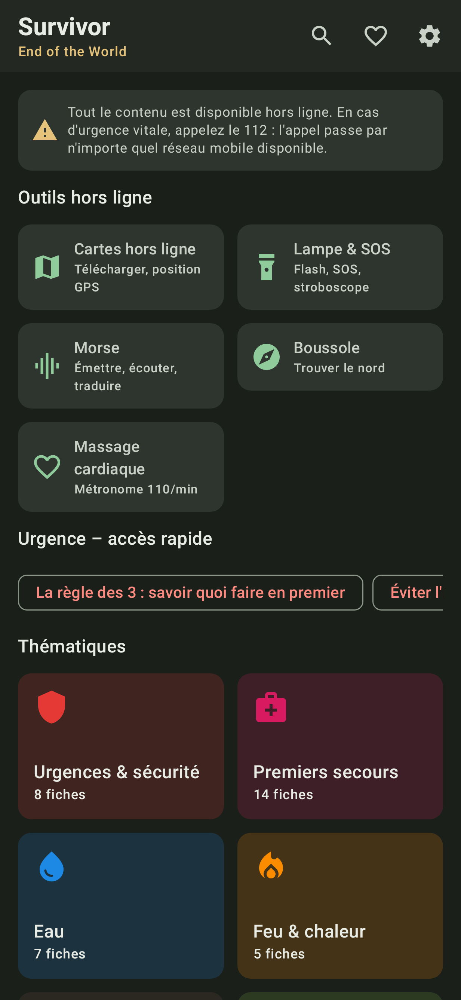
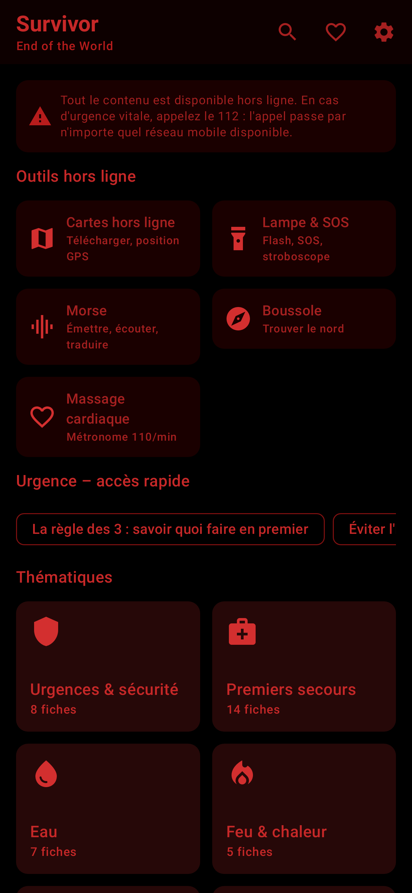
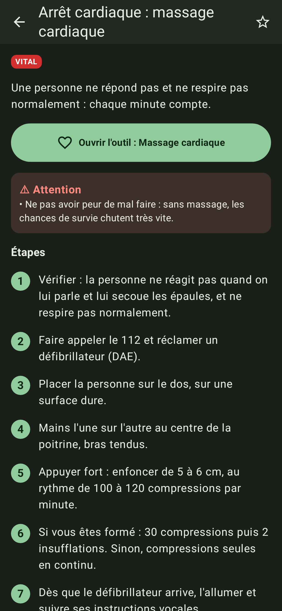
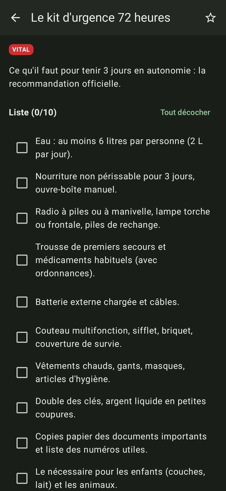
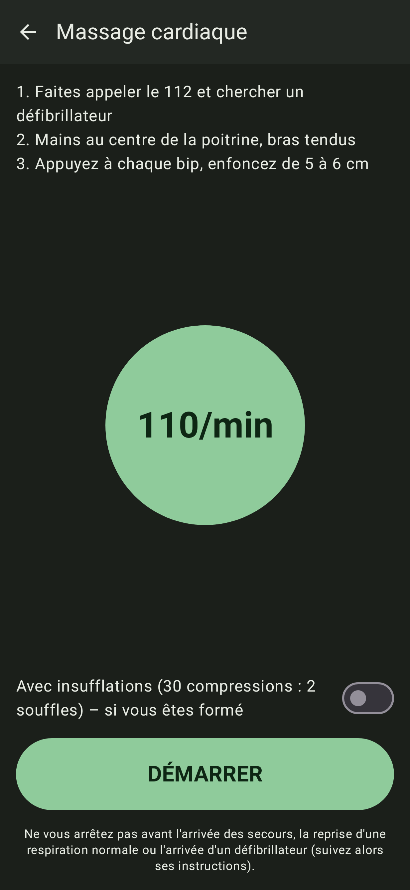

# Survive

Application Android de survie **entièrement hors ligne** : toutes les astuces et les gestes utiles
quand Internet, le réseau mobile ou l'électricité ne fonctionnent plus.

- 12 thématiques : urgences, premiers secours, eau, feu, abri, nourriture, orientation,
  communication sans réseau, énergie, hygiène, préparation, nœuds.
- 73 fiches pratiques sourcées (OMS, ERC, Croix-Rouge, gouvernement, manuels FM 21-76 / FM 3-97.61…).
- Outils intégrés : lampe & SOS automatique, émetteur Morse, boussole, métronome de massage cardiaque.
- Favoris, checklists mémorisées (kit 72 h, trousse, stock…), mode nuit rouge, grand texte.
- Recherche insensible aux accents, accès rapide aux gestes vitaux.
- Aucune permission Internet : rien ne dépend du réseau.

> ⚠️ Ce contenu ne remplace pas une formation aux premiers secours (PSC1) ni l'avis des secours.
> En cas d'urgence vitale : **112**.

## Compiler

### Sur le VPS (APK et .aab signés)

Une seule fois, pour installer le JDK 17 et le SDK Android (environ 1 Go) :

```bash
git clone https://github.com/aymenkssi/survive.git && cd survive
./scripts/build-vps.sh setup
```

Puis à chaque nouvelle version :

```bash
git pull
./scripts/build-vps.sh apk     # APK à installer sur un téléphone
./scripts/build-vps.sh aab     # .aab à envoyer sur Google Play
./scripts/build-vps.sh all     # les deux
```

- Le script vérifie d'abord le contenu (tests des fiches JSON et du Morse), puis compile en release (R8 activé).
- Les fichiers arrivent dans `~/builds/survive/` (`survive-<version>-<versionCode>.apk` / `.aab`).
  Pour les récupérer : `scp utilisateur@vps:builds/survive/*.apk .`
- La clé de signature est créée au premier build dans `~/.survive/` (jamais dans le dépôt).
  **Sauvegardez ce dossier** : la même clé doit signer toutes les mises à jour.
- Le `.aab` est accompagné de son fichier de désobscurcissement (`-mapping.txt`) : l'envoyer à Google Play
  avec le bundle pour pouvoir lire les rapports de plantage.
- Avant chaque build envoyé à Google Play : augmenter `versionCode` (et `versionName`) dans `app/build.gradle.kts`.

### En local (développement)

Prérequis : JDK 17+ et le SDK Android (API 35). Ouvrir le projet dans Android Studio, ou :

```bash
./gradlew assembleDebug   # APK : app/build/outputs/apk/debug/app-debug.apk
./gradlew test            # valide le contenu JSON, le Morse et les écrans
```

## Captures d'écran

| Accueil | Nuit rouge | Fiche | Checklist | Massage cardiaque |
|---|---|---|---|---|
|  |  |  |  |  |

Générées sans émulateur (Robolectric + Roborazzi) : `./gradlew recordRoborazziDebug` → `app/build/outputs/roborazzi/`.

## Documentation

- [docs/ARCHITECTURE.md](docs/ARCHITECTURE.md) – structure du code et feuille de route
- [docs/CONTENU.md](docs/CONTENU.md) – format des fiches, règles de rédaction, état de la collecte
- [docs/SOURCES.md](docs/SOURCES.md) – sources de référence et licences
